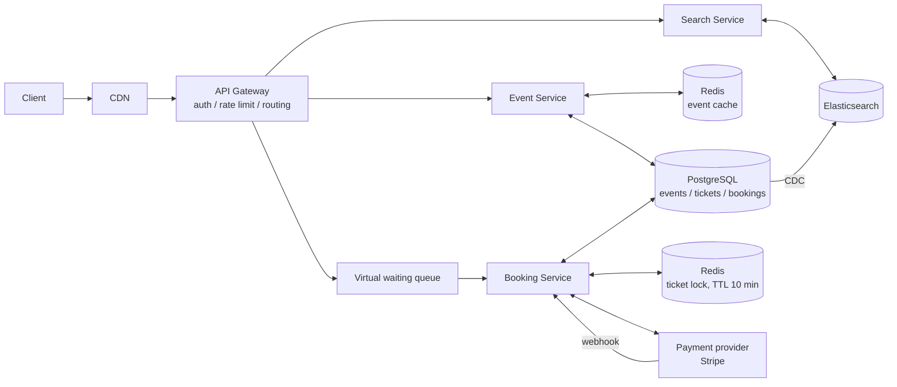

# 04: High-level design

Built one functional requirement at a time.

## 1. View events

Client -> API gateway (auth, rate limiting, routing) -> **Event Service** -> Postgres
(events, venues, performers).

## 2. Search events

Add a **Search Service**. Simplest version: query the events table with filters and
`LIKE '%term%'`. It works, but it's slow at scale (see deep dives section 5).

## 3. Book tickets

Add **Booking Service** plus `tickets` and `bookings` tables in the **same** Postgres
database. Booking needs a transaction across both tables, so sharing the database is the
right call here.

Simple booking flow, inside one transaction:

1. Check the selected tickets are available.
2. Mark them booked.
3. Insert the booking.
4. Commit, or fail if someone else got there first.

Its weakness: no hold, so you can lose the seat after typing in your card details. Deep dives
fix this.

## Final design (after the deep dives)

## What the lab actually runs

One app process with event, search and booking modules, plus Postgres, plus Redis from
step 5. The fake payment provider calls our webhook. Gateway, CDN and Elasticsearch appear
in the notes but aren't built unless a stretch step adds them. See the stack table in
`/CLAUDE.md`.
